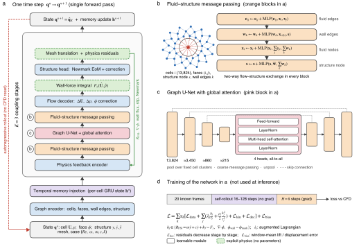

# FSIGraphNet

**A physics-constrained graph neural network for strongly coupled fluid–structure interaction.**

FSIGraphNet predicts the flow field and the structural response of vortex-induced vibration (VIV) jointly, one forward pass per time step, without a CFD solver at inference.

<p align="center">
  <b>Tandem cylinders · Re ≈ 100 · 13,824-cell native mesh · autonomous rollout over 4+ shedding cycles</b>
</p>

---

## Overview

- **One network, both physics.** A MeshGraphNet with a structure node outputs the flow field (u, v, p, face flux) and the rear-cylinder state (y, v, a) in each step. The structure node is coupled two-way to the wall cells through wall–structure edges.
- **Strong coupling inside the network.** Every step runs three fixed coupling stages: predict the flow → integrate the wall force → update the structure → move the mesh → feed physics residuals back into the network. No fixed-point iteration, no solve.
- **Physics in training, not in inference.** Fluid–structure equilibrium, continuity, wall no-penetration and Newmark kinematics are augmented-Lagrangian constraints in the loss. At inference they are only explicit evaluations fed back as features.
- **Trained for long horizons.** Before each training window the model rolls out 16–128 steps on its own outputs. Errors are therefore learned from the states the model actually reaches.

## Architecture

<p align="center"></p>

**a** One time step: three coupling stages inside a single forward pass, with physics residuals fed back between stages.
**b, c** Details of the message-passing and graph U-Net blocks in **a**. **d** Training scheme (not used at inference).

| Component | Setting |
|---|---|
| Graph | 13,824 cell nodes · 54,688 directed face edges · 1 structure node · 64 wall edges |
| Processor | 3 coupling stages; 3-level graph U-Net (→ ≈215 clusters) with 4-head global attention |
| Temporal memory | 64-d GRU state per cell |
| Structure head | Closed-form Newmark equation of motion with the predicted lift + learned correction |
| Parameters | 6.27 M (physics layers: 0) |

## Results

Development case F+ (unseen in training); autonomous 300-step prediction from 20 known frames.

| Metric | Cycle 1 | Cycle 2 | Cycle 3 | Cycle 4 |
|---|:-:|:-:|:-:|:-:|
| Displacement correlation | 1.00 | 1.00 | 1.00 | 1.00 |
| Frequency ratio | 0.98 | 1.02 | 1.03 | 0.98 |
| Phase error | 0° | 6° | 0° | 11° |
| Amplitude ratio | 1.04 | 0.90 | 0.76 | 0.76 |

Inference: 0.40 s per step on a single GB10 GPU (FP32).

## Installation

Use the NVIDIA PhysicsNeMo 26.06 container (PyTorch, CUDA). The released model is stored with Git LFS.

```bash
git lfs install && git lfs pull      # in a clone of this branch
export PYTHONPATH=src
```

## Quick start

**Inference.** A case directory holds `sequence.npz` and `report.json`. Only the first 20 frames are read.

```bash
python fsi_mgn_infer.py --checkpoint checkpoints/fsi_graphnet.pt \
    --case <case_dir> --steps 300 --out out/ --fields
```

**Training.** All hyperparameters are in `configs/fsi_graphnet.json`. Runs data-parallel with torchrun in a container.

```bash
tools/release.sh <tag> <root>
python3 tools/make_recipe.py <root> <run_id> <tag> [<init_checkpoint>]
python3 tools/launch_train.py <root> <root>/experiments/recipes/<run_id>.json
```

**Evaluation.** Each checkpoint gets a 300-step autonomous rollout, field and VIV metrics, and figures.

```bash
bash tools/eval_checkpoint.sh <root> <run_id> <update> <case>
```

**Tests.**

```bash
python tests/no_solver.py                      # forward path: torch, numpy, stdlib only; no solve
python tests/smoke.py '<case_json>' 0 2        # train == infer, gradients, timing
python tests/physics_truth.py '<case_json>'    # physics residuals on CFD truth
```

## Repository structure

```
configs/            model and training configuration
src/fsi_mgn/        model: data, physics (explicit, parameter-free), net, model, metrics
fsi_mgn_train.py    training
fsi_mgn_eval.py     evaluation
fsi_mgn_infer.py    inference
tools/              launch, release, evaluation, rendering
tests/              structural and physics checks
data/splits/        train / val / dev / held-out split
checkpoints/        released model
docs/               full documentation
```

## Documentation

The model, training, data, evaluation metrics and development history are covered in [docs/FSI_GRAPHNET.md](docs/FSI_GRAPHNET.md).

## References

- Pfaff et al., *Learning Mesh-Based Simulation with Graph Networks*, ICLR 2021.
- RealPDEBench, arXiv:2601.01829, for the field metrics.
- Williamson & Govardhan, *Vortex-Induced Vibrations*, Annu. Rev. Fluid Mech. 2004, for the VIV response metrics.
