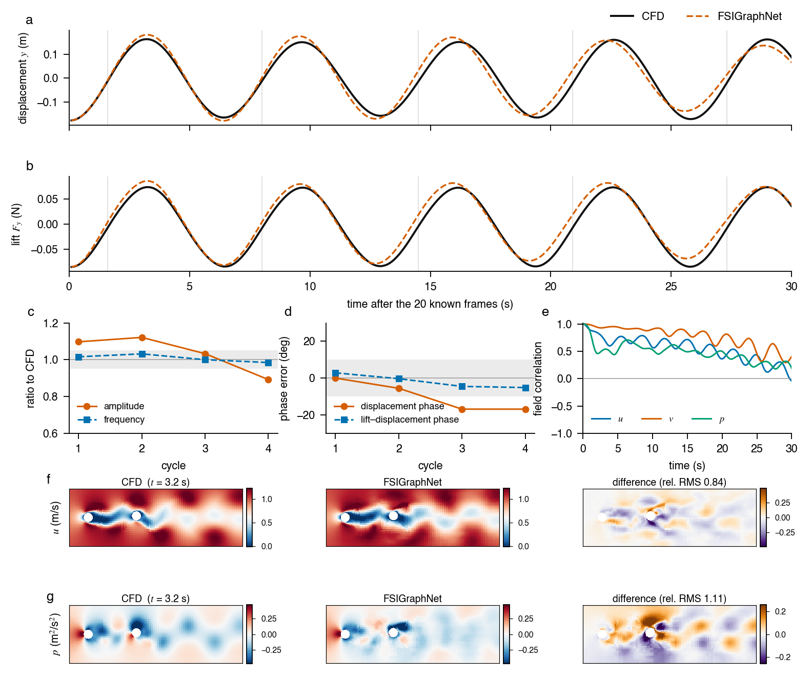

<h1 align="center">FSIGraphNet</h1>

<p align="center"><b>A physics-constrained graph neural network for strongly coupled fluid–structure interaction</b></p>

<p align="center">
  <a href="https://www.python.org/"></a>
  <a href="https://pytorch.org/"></a>
  <a href="https://github.com/NVIDIA/physicsnemo"></a>
  
  <a href="checkpoints/MANIFEST.json"></a>
  <a href="docs/FSI_GRAPHNET.md"></a>
  <a href="LICENSE"></a>
</p>

<p align="center">
  <a href="#overview">Overview</a> ·
  <a href="#architecture">Architecture</a> ·
  <a href="#dataset">Dataset</a> ·
  <a href="#metrics">Metrics</a> ·
  <a href="#results">Results</a> ·
  <a href="#installation">Installation</a> ·
  <a href="#quick-start">Quick start</a> ·
  <a href="docs/FSI_GRAPHNET.md">Docs</a> ·
  <a href="#license">License</a>
</p>

FSIGraphNet predicts the flow field and the structural response of vortex-induced vibration (VIV) jointly, one forward pass per time step, without a CFD solver at inference.

<p align="center">
  <b>Tandem cylinders · Re 75–110 · 26 CFD cases · 13,824-cell native mesh · autonomous rollout over 4+ shedding cycles</b>
</p>

---

## Overview

- **One network, both physics.** A MeshGraphNet with a structure node outputs the flow field (u, v, p, face flux) and the rear-cylinder state (y, v, a) in each step. The structure node is coupled two-way to the wall cells through wall–structure edges.
- **Strong coupling inside the network.** Every step runs three fixed coupling stages: predict the flow → integrate the wall force → update the structure → move the mesh → feed physics residuals back into the network. No fixed-point iteration, no solve.
- **Physics in training, not in inference.** Fluid–structure equilibrium, continuity, wall no-penetration and Newmark kinematics are augmented-Lagrangian constraints in the loss. At inference they are only explicit evaluations fed back as features.
- **Trained for long horizons.** Before each training window the model rolls out 16–128 steps on its own outputs. Errors are therefore learned from the states the model actually reaches.

## Architecture

<p align="center"></p>

**a** One time step: three coupling stages inside a single forward pass, with physics residuals fed back between stages.
**b, c** Details of the message-passing and graph U-Net blocks in **a**. **d** Training scheme (not used at inference).

| Component | Setting |
|---|---|
| Graph | 13,824 cell nodes · 54,688 directed face edges · 1 structure node · 64 wall edges |
| Processor | 3 coupling stages; 3-level graph U-Net (→ ≈215 clusters) with 4-head global attention |
| Temporal memory | 64-d GRU state per cell |
| Structure head | Closed-form Newmark equation of motion with the predicted lift + learned correction |
| Parameters | 6.27 M (physics layers: 0) |

## Dataset

All data come from 2-D incompressible CFD simulations run with OpenFOAM (`pimpleFoam`, moving mesh). The setup is two tandem cylinders of diameter *D* = 1 at 5*D* spacing. The front cylinder is fixed. The rear cylinder vibrates transversely on a spring–damper (*m* = 0.785, *c* = 0.0197, *k* = 1.24) and spins at a prescribed rate ω = ±0.1 rad/s. The mesh has 13,824 cells, and snapshots are written every Δ*t* = 0.1 s.

| Group | Conditions | Cases | Frames per case |
|---|---|:-:|:-:|
| Base | Re 100 (*U*<sub>∞</sub> = 1.0), ω = ±0.1; three independent runs C, E, F | 6 | 333–341 |
| Inflow | Re 75–110 (*U*<sub>∞</sub> = 0.75–1.10), branched from the base runs C/E by changing the inlet velocity, then 160 s of adaptation | 20 | 401 |

Each frame stores cell velocity and pressure, face fluxes, mesh points, and the rear-cylinder displacement, velocity, acceleration and forces. That is about 10,000 frames in total.

| Split | Cases | Role |
|---|---|---|
| TRAIN | 14: base C±, E±; inflow C± at *U*<sub>∞</sub> 0.75 / 0.8 / 0.85 / 0.9 / 1.1 | optimisation |
| VAL | 6: inflow E± at *U*<sub>∞</sub> 0.8 / 0.9 / 1.1 | selection |
| DEV | 2: base F± (separate runs at the training condition Re 100) | development; Results below |
| HELDOUT | 4: inflow C± at *U*<sub>∞</sub> 0.95 / 1.05 (conditions never trained on) | final acceptance only |

Case names and SHA-256 checksums are listed in `data/splits/fsi_viv.json`. The data files are not included in the repository. Each case is stored as `sequence.npz` plus `report.json`.

## Metrics

Each model is evaluated on a CFD run that is not part of the training data. Starting from 20 known frames, it rolls out 300 steps (≈ 4.7 shedding cycles) on its own outputs, without CFD reset. Cycles are delimited by upward zero crossings of the CFD displacement.

| Group | Metric | Definition | Target |
|---|---|---|:-:|
| Structure | Amplitude ratio | half peak-to-peak of <i>y</i> / CFD, per cycle | 1 ± 5 % |
| | Frequency ratio | <i>T</i><sub>CFD</sub> / <i>T</i>, per cycle | 1 ± 2 % |
| | Phase error | zero-crossing lag × 360° / <i>T</i> | ≤ 10° |
| | Lift RMS ratio | std(<i>F<sub>y</sub></i>) / std(<i>F</i><sub><i>y</i>,CFD</sub>) | 1 ± 10 % |
| | Energy-transfer error | cycle work ∮ <i>F<sub>y</sub> ẏ</i> d<i>t</i> vs CFD | ≤ 5 % |
| Flow field | Relative error | ‖<i>q̂</i> − <i>q</i>‖ / ‖<i>q</i> − <i>q̄</i><sub>t</sub>‖ for <i>u, v, p</i> | ≤ 1 at step 300 |
| | Field correlation | Pearson correlation of the fluctuations | ≥ 0.7 at step 150 |
| Physics | Residuals | <i>R</i><sub>FSI</sub>, continuity, wall flux, relative to their CFD floor | — |

The field metrics follow RealPDEBench, and the structural metrics follow standard VIV practice. Per-cycle structural metrics are computed in `src/fsi_mgn/metrics.py`.

## Results

DEV case F+ (a separate run at the Re 100 training condition), released model; 300-step autonomous rollout.

| Per cycle | 1 | 2 | 3 | 4 |
|---|:-:|:-:|:-:|:-:|
| Amplitude ratio | 1.04 | 0.90 | 0.76 | 0.76 |
| Frequency ratio | 1.00 | 1.02 | 1.00 | 1.00 |
| Phase error | 0° | 0° | −5.6° | −5.6° |
| Lift RMS ratio | 1.07 | 0.85 | 0.71 | 0.79 |
| Energy-transfer error | −1 % | −13 % | −12 % | −4 % |

| Step | 10 | 32 | 65 | 150 | 300 |
|---|:-:|:-:|:-:|:-:|:-:|
| Relative error <i>u</i> / <i>v</i> / <i>p</i> | 0.55 / 0.20 / 0.57 | 1.10 / 0.45 / 1.14 | 1.23 / 0.81 / 1.11 | 1.85 / 1.24 / 1.38 | 2.32 / 1.42 / 1.58 |
| Correlation <i>v</i> | 0.98 | 0.91 | 0.60 | −0.02 | −0.22 |

<p align="center"></p>

**a, b** Rear-cylinder displacement and lift against CFD; grey lines mark CFD cycles. **c, d** Per-cycle amplitude and frequency ratios, and phase errors; shaded bands show the targets. **e** Field correlation with CFD. **f, g** Velocity <i>u</i> and pressure <i>p</i> at <i>t</i> = 3.2 s.

The phase and frequency stay locked for four cycles. From cycle 3 on, the amplitude is ≈ 24 % low because the lift fluctuation is too weak. The flow field decorrelates from CFD after about one cycle.

Inference takes ≈ 0.4 s per step on a single GB10 GPU (FP32).

## Installation

Use the NVIDIA PhysicsNeMo 26.06 container (PyTorch, CUDA). The released model is stored with Git LFS.

```bash
git lfs install && git lfs pull      # in a clone of this branch
export PYTHONPATH=src
```

## Quick start

**Inference.** A case directory holds `sequence.npz` and `report.json`. Only the first 20 frames are read.

```bash
python fsi_mgn_infer.py --checkpoint checkpoints/fsi_graphnet.pt \
    --case <case_dir> --steps 300 --out out/ --fields
```

**Training.** All hyperparameters are in `configs/fsi_graphnet.json`. Runs data-parallel with torchrun in a container.

```bash
tools/release.sh <tag> <root>
python3 tools/make_recipe.py <root> <run_id> <tag> [<init_checkpoint>]
python3 tools/launch_train.py <root> <root>/experiments/recipes/<run_id>.json
```

**Evaluation.** Each checkpoint gets a 300-step autonomous rollout, field and VIV metrics, and figures.

```bash
bash tools/eval_checkpoint.sh <root> <run_id> <update> <case>
```

**Tests.**

```bash
python tests/no_solver.py                      # forward path: torch, numpy, stdlib only; no solve
python tests/smoke.py '<case_json>' 0 2        # train == infer, gradients, timing
python tests/physics_truth.py '<case_json>'    # physics residuals on CFD truth
```

## Repository structure

```
configs/            model and training configuration
src/fsi_mgn/        model: data, physics (explicit, parameter-free), net, model, metrics
fsi_mgn_train.py    training
fsi_mgn_eval.py     evaluation
fsi_mgn_infer.py    inference
tools/              launch, release, evaluation, rendering
tests/              structural and physics checks
data/splits/        train / val / dev / held-out split
checkpoints/        released model
docs/               full documentation
```

## Documentation

The model, training, data, evaluation metrics and development history are covered in [docs/FSI_GRAPHNET.md](docs/FSI_GRAPHNET.md).

## References

- Pfaff et al., *Learning Mesh-Based Simulation with Graph Networks*, ICLR 2021.
- RealPDEBench, arXiv:2601.01829, for the field metrics.
- Williamson & Govardhan, *Vortex-Induced Vibrations*, Annu. Rev. Fluid Mech. 2004, for the VIV response metrics.

## License

Copyright 2026 the FSIGraphNet authors. Released under the [Apache License 2.0](LICENSE).
